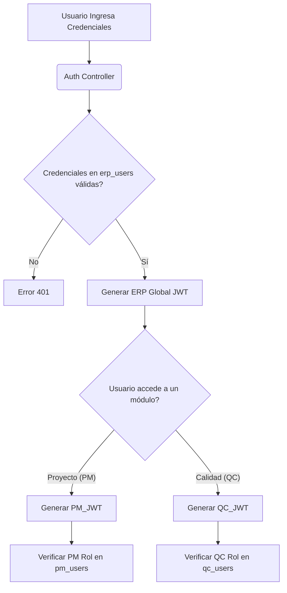

# ⚙️ Business ERP - Backend API

Esta es la capa de servicios backend del monorepositorio **Business ERP**. Está construida con Node.js, Express y Prisma ORM bajo el patrón de **Arquitectura Limpia (Clean Architecture)**.

## 🚀 Tecnologías Principales

- **Framework:** Express.js 5
- **Lenguaje:** TypeScript
- **Base de Datos:** PostgreSQL
- **ORM:** Prisma 7
- **Validación:** Zod
- **Autenticación:** JWT (JSON Web Tokens)
- **Seguridad:** bcryptjs, helmet, cors
- **Generación de Reportes:** Puppeteer (PDF)

---

## 🏛️ Arquitectura del Proyecto

El backend está migrando de una estructura tradicional (`features/`) hacia una arquitectura modular estricta basada en **Clean Architecture** y **Hexagonal Architecture** (`modules/`).

### Estructura de Directorios

```text
apps/backend/
├── prisma/
│   ├── schema/           # Modelos de BD divididos por submódulos (auth, pm, qc, executive)
│   ├── migrations/       # Historial de migraciones SQL
│   └── seed/             # Scripts para poblar la BD
├── src/
│   ├── config/           # Configuración global (env, base de datos, constantes)
│   ├── middlewares/      # Middlewares globales (manejo de errores, parsing)
│   ├── modules/          # 🌟 NUEVA ARQUITECTURA LIMPIA (Recomendado)
│   │   ├── project-management/
│   │   ├── quality-control/
│   │   └── ...
│   ├── features/         # ⚠️ ARQUITECTURA LEGACY (En proceso de migración)
│   └── index.ts          # Punto de entrada de la aplicación
├── uploads/              # Directorio de persistencia para archivos (Galerías)
└── package.json          # Dependencias y scripts
```

### Patrón Clean Architecture (Carpeta `modules/`)

Cada módulo (por ejemplo, `project-management`) está completamente aislado y dividido en 4 capas estrictas. **La regla de dependencia establece que las dependencias en el código fuente solo pueden apuntar hacia adentro**.

1. **`domain/` (Capa de Dominio - Núcleo)**:
   - Contiene las **Entities** puras (clases TypeScript sin dependencias externas).
   - Define las **Interfaces de los Repositorios** (Contratos).
   - Contiene reglas de negocio críticas.

2. **`application/` (Capa de Aplicación)**:
   - Contiene los **Casos de Uso** (`use-cases/`) y **Servicios**.
   - Coordina la lógica de negocio consumiendo las interfaces del dominio.
   - Contiene los **DTOs** (Data Transfer Objects) tipados y validados con **Zod**.

3. **`infrastructure/` (Capa de Infraestructura)**:
   - Implementa las interfaces definidas en el dominio.
   - Aquí vive la integración con **Prisma** (`prisma-*.repository.ts`).
   - Conexiones a servicios externos (Mailers, Storage, Redis).

4. **`interface/` (Capa de Interfaz / Presentación)**:
   - Contiene los **Controllers** (procesan req y res de Express).
   - Define las **Rutas** HTTP.
   - Implementa los Middlewares de protección (Auth y Roles específicos del módulo).

---

## 🔄 Flujos de Procesamiento Interno (Lifecycles)

Para comprender cómo opera el backend por debajo, a continuación se detallan los flujos principales de sus rutinas críticas.

El monorepo sirve a varios submódulos. No existe un token único y global para todas las acciones operativas, sino que se firman tokens especializados:


> **Nota de Seguridad**: Si un usuario con el token global intenta entrar a `/api/project-management/empresas`, el middleware `pmAuthMiddleware` lo rechazará. Exigirá un JWT firmado específicamente con `PM_JWT_SECRET`.

### 3. Flujo de Generación de Reportes PDF (Puppeteer)
El módulo de Control de Calidad utiliza Puppeteer para exportar PDFs idénticos al dashboard:

1. **Trigger**: El `QC_AUDITOR` dispara la ruta GET de exportación de reporte.
2. **Data Fetching**: El backend consulta Prisma y consolida todos los Indicadores y Mediciones del período solicitado.
3. **HTML Renderizado**: Se inyecta la data en una plantilla de Handlebars/Pug o HTML crudo.
4. **Instanciación de Navegador**: Se lanza un Chromium en modo _headless_.
5. **Conversión**: Chromium carga el HTML y lo imprime como un Buffer en memoria (`page.pdf()`).
6. **Delivery**: El Buffer se transmite por streaming hacia el Frontend con el Header `Content-Type: application/pdf`.

### 4. Flujo de Archivos y Galería (Storage)
Cuando el planificador adjunta evidencia fotográfica:

1. **Multipart/form-data**: La petición es interceptada por el middleware **Multer**.
2. **Validación**: Multer rechaza archivos que no sean imágenes/PDFs o que pesen más del límite permitido.
3. **Escritura en Disco**: El archivo se guarda en la carpeta `./uploads/[Company|Project]/<uuid>`. En producción (Railway), esto es un **Volumen Persistente**.
4. **Registro DB**: Se guarda en la tabla `pm_gallery_files` la URL relativa (`/uploads/...`) vinculada al `projectId`.

---

## 💾 Base de Datos y Prisma

El sistema utiliza **PostgreSQL**. Por convención del ERP, como en un monorepositorio conviven varios módulos, las tablas están prefijadas lógicamente:

- `erp_*`: Core del sistema (Usuarios base, Roles globales).
- `pm_*`: Project Management (Empresas, Proyectos, Avances físicos).
- `qc_*`: Quality Control (Indicadores, Procesos, Mediciones).
- `executive_*`: Módulo Directivo Ejecutivo.

### Comandos útiles de Prisma

> **Nota:** Todos los comandos de Prisma deben ejecutarse desde el directorio raíz del monorepositorio o anteponiendo `pnpm --filter backend`.

- Generar tipos (después de cambiar el `schema.prisma`):
  ```bash
  pnpm prisma:generate
  ```
- Crear una nueva migración (en desarrollo):
  ```bash
  pnpm prisma:migrate:dev --name nombre_descriptivo
  ```
- Aplicar migraciones pendientes:
  ```bash
  pnpm prisma:migrate
  ```
- Abrir la interfaz gráfica de la base de datos:
  ```bash
  pnpm prisma:studio
  ```

---

## 🔐 Autenticación y Autorización

Dado que es un monorepo multitenant a nivel lógico, cada módulo maneja su propia estrategia de token:

- **JWT_SECRET:** Token raíz del ERP.
- **PM_JWT_SECRET:** Token firmado exclusivamente para permisos de Project Management.
- **QC_JWT_SECRET:** Token para Quality Control.

Los **Middlewares de Roles** (`pmCheckRoles`, `qcCheckRoles`) interceptan las rutas y validan si el usuario extraído del JWT tiene el perfil requerido (ej. `PM_ADMIN`, `PM_PLANIFICADOR`, `QC_EVALUADOR`).

---

## 🛠️ Desarrollo y Scripts

Para correr el backend en entorno local de manera aislada (aunque recomendamos usar `pnpm dev` en la raíz):

```bash
# Entrar al backend
cd apps/backend

# Iniciar servidor en modo desarrollo (watch mode usando tsx)
pnpm dev

# Compilar para producción
pnpm build

# Iniciar en producción (requiere build previo)
pnpm start
```

## 🧪 Testing

El proyecto utiliza el test runner nativo de Node.js (`node:test`).
Para ejecutar las pruebas:

```bash
pnpm test
# Para ejecutar las pruebas específicas de un módulo (ej. Project Management)
pnpm test:pm
```

## 📝 Convenciones de Código Backend

1. **Nunca** importar directamente a Prisma en la capa de `application/` o `domain/`. Prisma solo debe existir en `infrastructure/`.
2. Las peticiones entrantes deben ser validadas usando **Zod** en la capa `application/dto/`.
3. Los controladores (`interface/controllers/`) deben ser lo más delgados posibles. Su única responsabilidad es recibir el Request, llamar al Use Case y enviar la Response. No deben contener lógica de negocio.
4. Usa los Custom Errors definidos en el sistema (ej. `DomainError`, `ValidationError`) para que el Middleware global de manejo de errores parsee el HTTP Status Code correcto automáticamente.
