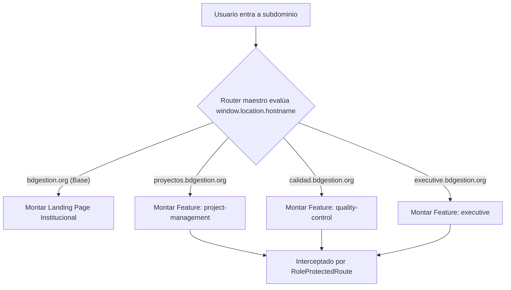

# 🖥️ Business ERP - Frontend SPA

Esta es la aplicación principal (Single Page Application) que consumen los usuarios finales del **Business ERP**. Está construida para ser un hub centralizado (un único despliegue) que sirve múltiples submódulos (Proyectos, Calidad, Ejecutivo) dependiendo del subdominio de acceso.

## 🚀 Tecnologías Principales y Razonamiento

- **React 19 + Vite 5**: Vite ofrece Hot Module Replacement (HMR) casi instantáneo, mientras que React 19 introduce el React Compiler nativo.
- **TypeScript**: Estricto. Garantiza la sanidad del código entre las respuestas del backend y los props del frontend.
- **Tailwind CSS 4**: Se usa para estilos de utilidad puros. No se escriben hojas de estilo CSS tradicionales (salvo el `index.css` global).
- **Shadcn UI (Radix UI)**: Los componentes base (modales, inputs, selects, tablas) no son dependencias npm opacas, sino que su código fuente se inyecta directamente en `src/components/ui`.
- **Recharts**: Para todas las visualizaciones de datos, curvas S y dashboards.
- **React Router v6**: Enrutamiento del lado del cliente.
- **Zustand**: Para manejo de estado global ligero (ej. sesión, temas).

---

## 🏛️ Arquitectura del Proyecto (Feature-Driven)

El frontend utiliza una arquitectura orientada a "Features" (características funcionales). Esto evita que la aplicación se vuelva un espagueti a medida que crece.

```text
apps/frontend/
├── public/                 # Favicons y assets estáticos públicos.
├── src/
│   ├── assets/             # Imágenes y logos corporativos puros (business.webp).
│   ├── components/         # 🧩 Componentes "Tontos" y Globales
│   │   ├── ui/             # Componentes Shadcn inyectados (Botones, Inputs, Modales).
│   │   └── ProtectedRoutes/# Middlewares visuales como RoleProtectedRoute.
│   ├── config/             # Configuración del SPA (URLs base, variables de entorno).
│   ├── features/           # 🌟 NÚCLEO DE LA APLICACIÓN (Módulos de negocio aislados)
│   │   ├── auth/           # Rutas y páginas globales de Login.
│   │   ├── project-management/ # 🏗️ Módulo: Proyectos, Avance Físico, Galería.
│   │   ├── quality-control/    # 🔍 Módulo: Auditorías, KPIs, Exportación a PDF.
│   │   └── executive/          # 📊 Módulo: Tablero de alto nivel del Directorio.
│   ├── layouts/            # Contenedores maestros (MainLayout, AuthLayout, AppShells).
│   ├── lib/                # Utilidades "puras" de JS/TS (cn para tailwind, fetchers).
│   ├── pages/              # Páginas de uso general (Landing Page de la empresa en bdgestion.org).
│   ├── routes/             # Árbol maestro de enrutamiento (Index.tsx).
│   ├── shared/             # Lógica transversal (hooks de notificaciones useToast, tipos compartidos).
│   ├── App.tsx             # Proveedor maestro (Theme, ToastProvider, RouterProvider).
│   └── main.tsx            # Punto de inyección en el DOM genérico.
```

---

## 🔄 Flujos de Operación Detallados (Lifecycles)

### 1. El Flujo de Enrutamiento Dinámico por Subdominio
El ERP no despliega 3 frontends distintos. Despliega **uno solo** y el código React lee la URL en el navegador del usuario para saber qué módulo inyectar:

1. **Petición del navegador:** El usuario entra a `calidad.bdgestion.org`.
2. **`domains.ts` (Config):** La aplicación extrae el string `"calidad"` del hostname de la ventana (`window.location.hostname`).
3. **`App.tsx` (Router Switch):** Un router maestro envuelve la app y evalúa el dominio. Al detectar `"calidad"`, desecha el código de Proyectos y carga asíncronamente el componente `QualityControlRoutes`.
4. **Montaje Exclusivo:** El usuario solo ve los menús, colores e interfaces del módulo de Control de Calidad.



### 2. El Flujo de Fetching y Renovación de Tokens (Intercepción)
Todas las llamadas al Backend API en el frontend **no** usan `fetch` directamente, usan un contenedor especial llamado `fetchWithRefresh` (ubicado en `src/lib/api`).

1. **Trigger de UI:** El usuario hace clic en "Guardar Empresa".
2. **Request Original:** `fetchWithRefresh` arma la petición POST con el Bearer Token actual sacado del LocalStorage o Zustand.
3. **Respuesta del Servidor:**
   - **Caso A (200 OK):** Todo sale bien, retorna la data al componente.
   - **Caso B (401 Unauthorized):** El token caducó.
4. **Auto-Renovación (Silent Refresh):** Sin avisarle al usuario, `fetchWithRefresh` intercepta el 401, dispara una petición POST al endpoint de `/refresh-token` enviando la cookie/token de refresco.
5. **Reintento Transparente:** El servidor devuelve un nuevo Access Token. `fetchWithRefresh` actualiza el token en memoria y vuelve a disparar el POST original ("Guardar Empresa").
6. **Éxito:** El usuario ve un Toast de guardado exitoso y nunca se enteró de que su sesión había caducado y se renovó sola.

### 3. El Flujo de Renderizado de un Componente (Patrón Container/Presentational)
Dentro de la carpeta `features/`, aplicamos separación de responsabilidades:

1. **View/Container (`ProjectsDashboardView.tsx`):**
   - No tiene `divs` estilizados.
   - Su trabajo es usar Hooks (`useQuery`, `useEffect`, llamadas API) para recolectar toda la información bruta (Usuarios, KPIs, Proyectos).
   - Maneja los estados de Loading (`isLoading`) o Errores (`isError`).
2. **Components (`ProjectListTable.tsx` / `StatCard.tsx`):**
   - Son "Componentes Tontos". Reciben la data a través de `props` (ej: `<ProjectListTable data={proyectos} />`).
   - Aquí vive el HTML, el Tailwind y el diseño visual.
   - Si un usuario hace clic en un botón, este componente no llama a la API, sino que emite una función recibida por props (`onDelete={handleDelete}`).

### 4. El Flujo de Seguridad y Protección de Rutas (RoleProtectedRoute)
Las rutas sensibles están envueltas en el componente `<RoleProtectedRoute allowedRoles={['pm_gestion', 'pm_admin']}>`.

1. **Interceptación:** Antes de renderizar la página, el componente actúa.
2. **Parsing de JWT:** Toma el string del token JWT del usuario, lo decodifica en base64 y extrae la propiedad `role`.
3. **Limpieza (Normalization):** Como los roles en BD pueden decir `PM_ADMIN` pero en el código del router configuramos `admin`, el componente hace una normalización (quita prefijos `PM_`, `QC_` y pasa a minúsculas).
4. **Evaluación:** Compara si el rol normalizado está dentro del array de `allowedRoles`.
5. **Redirección:** Si falla, monta `<Navigate to="/unauthorized" />`. Si pasa, monta el `<Outlet />` (los hijos de la ruta).

---

## 📦 Desglose Funcional de Módulos (Features)

Para entender cómo operan las reglas de negocio del lado del cliente, aquí se detallan de forma generalizada las responsabilidades de los cuatro módulos principales que viven dentro de `src/features/`.

### 🔐 1. Módulo Auth (`features/auth`)
Es un módulo híbrido y agnóstico. 
- **Funcionalidad:** Proporciona las pantallas universales de Inicio de Sesión (`LoginPage`) y las vistas para recuperar contraseña.
- **Mecánica:** Aunque la vista de login sea la misma visualmente, se adapta al contexto. Si el usuario está en `calidad.bdgestion.org`, el formulario hace `POST /api/quality-control/auth/login`. Si está en proyectos, apunta a `/api/project-management/auth/login`. 
- **Estado:** Utiliza persistencia para guardar en el navegador el Token, Refresh Token y los datos del perfil de usuario que acaba de ingresar.

### 🏗️ 2. Módulo Project Management (`features/project-management`)
Es el submódulo más denso. Contiene la interfaz de gestión de obras de construcción e ingeniería.
- **Gestión de Empresas y Proyectos:** Vistas tipo "Dashboard" y "Tablas CRUD" donde el Backoffice puede enlistar a sus clientes, crearles proyectos y asignar planificadores mediante menús selectores de Shadcn.
- **Finanzas y Costos:** Componentes altamente interactivos que usan `Recharts` para dibujar las "Curvas S" comparando el presupuesto planeado mes a mes contra la inversión real ejecutada.
- **Avance Físico:** Formularios dinámicos donde los planificadores entran periódicamente para cargar el porcentaje de avance de sus proyectos.
- **Galería Integrada:** Un mini "Google Drive" interno donde se consumen servicios para cargar (`Multipart/form-data`) imágenes, previsualizarlas en una grilla y borrarlas.

### 🔍 3. Módulo Quality Control (`features/quality-control`)
Este módulo es puro análisis y cumplimiento de normativas ISO.
- **Taxonomía en Árbol:** Interfaces diseñadas para construir "Procesos", dentro de ellos "Sub-procesos" y dentro "Indicadores (KPIs)". 
- **Formularios de Medición:** Vistas estructuradas donde el `QC_EVALUADOR` puede ver una lista de tareas pendientes del mes y cargar el resultado exacto (ej. "85%") para un KPI.
- **Dashboard de Auditoría:** Contiene botones de acción crítica que le envían al backend la orden de renderizar toda la pantalla en un PDF formal (Puppeteer) para descargarlo automáticamente en el navegador del auditor.

### 📊 4. Módulo Executive (`features/executive`)
Es la sala de mando del directorio.
- **Simplicidad Visual:** A diferencia de proyectos, este módulo no tiene casi formularios de carga. Su objetivo es un 90% visualización de datos.
- **Consolidated Report:** Una única página super densa en datos, llena de "Tarjetas de Resumen" (Stat Cards) y gráficos circulares que agregan la facturación total y el cumplimiento estratégico de toda la corporación, consolidando la data de todas las empresas.

---

## 🎨 Modificación y Fusión de Estilos (El patrón `cn`)

Nunca escribimos strings de clases Tailwind concatenados con `+`. Siempre usamos la utilidad `cn` (importada de `@/lib/utils`):

```tsx
import { cn } from "@/lib/utils"

// ❌ Incorrecto (Genera conflictos de Tailwind)
<div className={`px-4 py-2 bg-blue-500 ${props.className}`}>

// ✅ Correcto (clsx evalúa lógicas, tailwind-merge elimina conflictos)
<div className={cn(
  "px-4 py-2 bg-blue-500", // Clases base
  isActive && "border-2 border-white", // Clases condicionales lógicas
  props.className // Clases externas sobreescriben correctamente
)}>
```

---

## 🛠️ Comandos de Desarrollo Locales

```bash
# Navegar al directorio del frontend
cd apps/frontend

# Iniciar servidor de desarrollo en http://localhost:5173
pnpm dev

# Compilar para producción (Genera index.html y assets en dist/)
pnpm build

# Correr ESLint para asegurar calidad del código
pnpm lint
```
